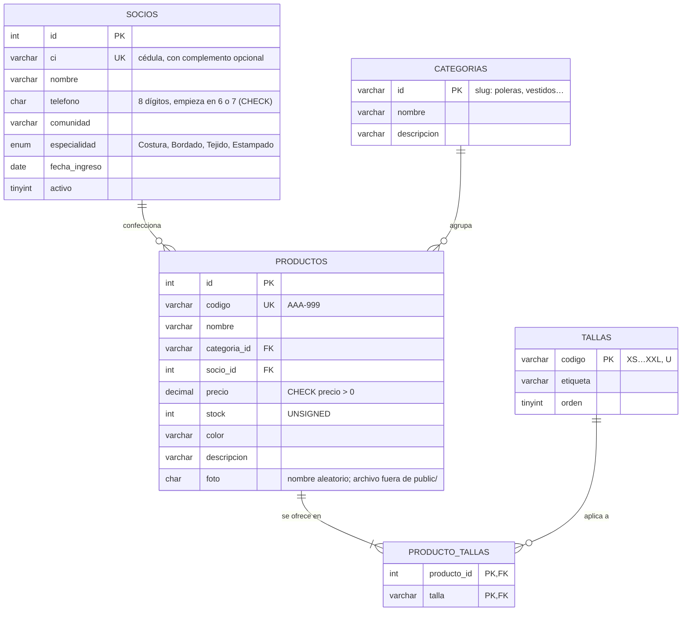

# Modelo entidad-relación: Manos del Oriente (Actividad 2)

Script: [`bd/esquema.sql`](../../bd/esquema.sql) · Datos de ejemplo: [`bd/datos.sql`](../../bd/datos.sql) · Instalación: `php bd/instalar.php`

## Decisiones de diseño

| Decisión | Motivo |
|---|---|
| `socios` es una entidad propia (antes era un texto libre en el JSON) | Evita nombres escritos de formas distintas y permite consultar cuántas prendas aporta cada socio |
| `producto_tallas` (muchos a muchos) en lugar de una columna «S,M,L» | Primera forma normal: cada talla es una fila, se puede filtrar con `EXISTS` y la FK impide tallas inexistentes |
| `ON DELETE RESTRICT` en `productos.socio_id` y `productos.categoria_id` | No se puede borrar una socia o una categoría que tiene prendas: no quedan prendas «huérfanas» |
| `ON DELETE CASCADE` en `producto_tallas.producto_id` | Al borrar una prenda, sus tallas se borran solas |
| `UNIQUE` en `productos.codigo` y `socios.ci` | Última defensa contra duplicados aunque dos personas guarden a la vez |
| `CHECK` en precio y teléfono, `UNSIGNED` en stock, `ENUM` en especialidad | Las reglas del negocio también viven en la base, no solo en PHP |
| `DECIMAL(10,2)` para el precio | Los montos de dinero no se guardan en coma flotante |
| `utf8mb4` + `InnoDB` | Acentos y ñ (Chuvé, saó) y soporte de claves foráneas y transacciones |

## Verificación de los datos de ejemplo (a mano)

| Socio | Prendas |
|---|---:|
| Rosa Chuvé Supepí | 3 |
| Elena Masabí Tomichá | 3 |
| Mario Surubí Peña | 3 |
| Juana Pesoa Rojas | 3 |
| Lidia Choré Vaca | 2 |
| Carmen Parapaino Masaí (inactiva) | 0 |
| **Total** | **14** |

Inventario: Σ precio × stock = **Bs 19.538,50** en **157 unidades** (comprobado con `SUM(precio * stock)` y en la página de gestión).
