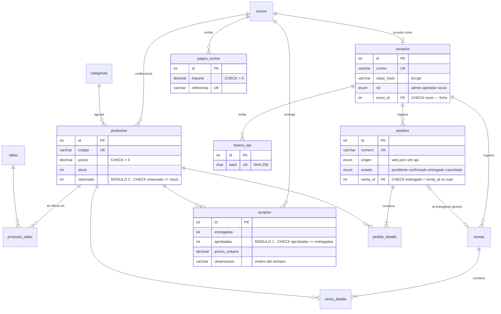

# Modelo de datos

13 tablas InnoDB, 18 claves foráneas (`php verificar.php` lo comprueba). Scripts en [`bd/`](../../bd/):
`esquema.sql` y `datos.sql` (actividad 2) · `04-usuarios.sql`, `05-movimientos.sql` (actividad 3) · `06-tokens.sql`
(actividad 4) · `07-tfi.sql` (módulos nuevos) · `08-demo.sql` (movimientos de prueba).

## Decisiones

| Decisión | Por qué |
|---|---|
| El **saldo** de la socia se calcula (no hay columna `saldo`) | Nunca queda desactualizado; un pago o un acopio nuevo se refleja al instante |
| Liquidado con **subconsultas** separadas | Un `JOIN` de acopios con pagos multiplicaría filas y duplicaría los montos |
| `reservado` en `productos` + `CHECK (reservado <= stock)` | La base es la última defensa aunque falle la aplicación |
| Entregar = venta + baja de stock y reserva en **una transacción** con `FOR UPDATE` | Dos operadores no pueden entregar/vender la misma unidad a la vez |
| Precio del detalle guardado en la venta y el pedido | El precio del catálogo puede cambiar; lo vendido no |
| `ON DELETE RESTRICT` en ventas, acopios y pedidos | No se borra el historial: la API responde 409 |
| Tokens: solo el hash SHA-256 | Si se filtra la tabla, los tokens no sirven |
| `CHECK` usuario socio ⇔ ficha de socia | Una socia siempre está vinculada a sus datos (privacidad por diseño) |

## Cifras de los datos de demostración (calculadas a mano)

**Módulo 1 — liquidación** (`aprobadas × precio` de cada acopio)

| Socia | Acopios | Aprobadas/entregadas | Liquidado | Pagado | Saldo |
|---|---|---|---|---|---|
| Rosa Chuvé Supepí | POL-001 18×50 = 900 · VES-100 4×200 = 800 | 22/24 | 1.700,00 | 1.000,00 | **700,00** |
| Elena Masabí Tomichá | POL-002 9×65 = 585 · VES-101 3×160 = 480 | 12/13 | 1.065,00 | 585,00 | **480,00** |
| Mario Surubí Peña | ACC-300 28×40 = 1.120 | 28/30 | 1.120,00 | 1.120,00 | **0,00** |
| Juana Pesoa Rojas | PAN-010 12×100 = 1.200 | 12/12 | 1.200,00 | 600,00 | **600,00** |
| Lidia Choré Vaca | ACC-302 22×25 = 550 | 22/25 | 550,00 | 0,00 | **550,00** |
| Carmen Parapaino Masaí (inactiva) | — | 0/0 | 0,00 | 0,00 | 0,00 |
| **Total** | | | **5.635,00** | **3.305,00** | **2.330,00** |

**Módulo 2 — pedidos:** OC-ART-0101 (pendiente) reserva 4 × POL-003 (85) + 2 × ACC-301 (90) = **Bs 520,00**;
PED-000002 (cancelado) no reserva nada. POL-003: stock 18, reservado 4 → **14 libres**.

**Ventas (actividad 3):** 6 ventas, 27 prendas, **Bs 3.287,50** (julio 965,00 · agosto 1.280,00 · septiembre 1.042,50).

**Inventario (actividad 2):** 14 prendas, 157 unidades, **Bs 19.538,50**.
